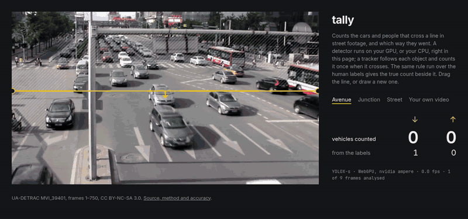

# tally

A street counter that runs in the browser. It watches traffic footage, finds the cars, buses,
trucks, bikes and people in each frame on your GPU, follows each one, and counts it once when it
crosses a line, split by direction. Nothing is uploaded. Next to its own count, the page shows
the true count for the same line, from the human labels of the footage.



<sub>Recorded with `pnpm demo`: the built page on WebGPU, an RTX 3050 Laptop GPU, real time.</sub>

**Try it:** [iliev-blnk.github.io/tally](https://iliev-blnk.github.io/tally/). Drag the
line, draw a new one, or drop in a video of your own street; it stays on your device.

## How accurate

<!-- accuracy -->
| model | every frame | every 2nd | every 3rd | bias | vehicles | people |
| --- | ---: | ---: | ---: | ---: | ---: | ---: |
| YOLOX-nano | 38.2% | 41.8% | 43.9% | −38.2% | 38.1% | 45.5% |
| YOLOX-tiny | 21.2% | 22.7% | 25.3% | −18.8% | 20.8% | 42.4% |
| YOLOX-s | 9.0% | 10.4% | 11.9% | −6.1% | 8.6% | 30.3% |
| D-FINE-s | 9.6% | 8.7% | 9.3% | −1.2% | 9.2% | 30.3% |

WAPE of line counts against the labels, over 1,729 labelled crossings in 40 UA-DETRAC test sequences and MOT17-02 and -04. Lower is better; bias is the signed total error (negative: undercounts). "Every 2nd" and "every 3rd" analyse only those frames, as a device that runs at a half or a third of the video frame rate would.
<!-- /accuracy -->

Every number is from footage the counter was not tuned on. Thresholds and tracker settings were
chosen on a separate split (8 UA-DETRAC training sequences and MOT17-09), then frozen. Per-sequence
results are in [`bench/results`](bench/results).

## How fast

<!-- speed -->
| model | RTX 3050 Laptop, WebGPU | CPU, WASM: 11th Gen Intel Core i5-11320H, 8 threads |
| --- | ---: | ---: |
| YOLOX-nano | 13 ms · 76.8 fps | 35.6 ms · 28.1 fps |
| YOLOX-tiny | 16.1 ms · 62.2 fps | 101.6 ms · 9.8 fps |
| YOLOX-s | 44.2 ms · 22.6 fps | 392 ms · 2.6 fps |
| D-FINE-s | 68.9 ms · 14.5 fps | 471.8 ms · 2.1 fps |

Median time per frame for preprocessing, inference and decoding, over 200 frames after 20 warm-up frames, in Chromium 152.0.7977.82.
<!-- /speed -->

<!-- defaults -->
The page picks its model from these numbers: YOLOX-s on WebGPU, the most accurate model that holds 20 fps on the RTX 3050, and YOLOX-tiny on WASM, the most accurate that holds 8 fps on the CPU (or the fastest, if none does). `?model=` overrides it.
<!-- /defaults -->

## How it counts

```
video frame ──▶ detector (worker) ──▶ ignore zones ──▶ tracker ──▶ line counter ──▶ counts by kind
 newest one      ONNX Runtime Web       drop boxes       Kalman +     centre crosses     and direction
 when free       WebGPU, else WASM      centred in them  IoU matching the segment
```

- **Detection.** COCO-pretrained [YOLOX](https://github.com/Megvii-BaseDetection/YOLOX) and
  [D-FINE](https://github.com/Peterande/D-FINE) models, used as they are, in
  [ONNX Runtime Web](https://onnxruntime.ai/) inside a worker. WebGPU when the browser has it,
  WebAssembly with threads otherwise. No training or fine-tuning.
- **Tracking.** ByteTrack-style: a constant-velocity Kalman filter per object, then two rounds
  of IoU matching with the Hungarian algorithm, confident detections first and weak ones
  second. A track's kind is the majority vote of its detections.
- **Counting.** A track is counted when its box centre moves from one side of the line to the
  other between two observations, and the step crosses the segment itself, not its extension.
  Each track counts once, in the direction it first crossed.
- **The true count** is the same rule run over the labelled tracks, for the same line.
- **Live.** The video plays in real time and the detector takes the newest frame whenever it is
  free, so a slower device analyses fewer frames. The "every 2nd / 3rd" columns above say what
  that costs.

## Limitations

- **COCO classes.** The models know car, bus, truck, motorcycle, bicycle and person. UA-DETRAC's
  labels in the mirror used here don't keep the car/bus/van split, so vehicles are scored as one
  class.
- **Bikes and scooters aren't scored.** UA-DETRAC doesn't label them, so on its clips they are
  dropped before tracking, the same on the page as in the benchmark.
- **Distance and occlusion.** Most misses are far, small vehicles, often behind a railing or a
  bus, and the counter undercounts there rather than over. The per-sequence results show where.
  The page's Junction clip comes from the sequence with the most miscounts: over the full
  sequence YOLOX-s counts 9 of the 36 vehicles going left, and 47 of the 52 going right.
- **One camera, fixed.** No moving cameras, no counting across cameras.
- **Blanked frames.** Chromium on a Linux laptop with Intel and NVIDIA graphics gave the page
  only black video frames while GPU compositing was on, so nothing was detected. The page says
  so when every frame is black; turning off hardware video decoding fixed it there.

## Reproduce

Needs Node 24, pnpm, Chromium and ffmpeg. The benchmark footage (about 10 GB of frames) is read
straight out of the public zips with HTTP range requests, so only the sequences used are
downloaded. It goes to `$EDGE_DATA`, by default `~/DEV/edge-data`.

```sh
pnpm install
pnpm models                                # detector models + ONNX Runtime into site/public
pnpm dev                                   # the page, on http://localhost:5173

npx tsx bench/data.ts                      # UA-DETRAC + MOT17 frames and labels
npx tsx bench/detect.ts --split tune       # detections, in headed Chromium on WebGPU, cached
npx tsx bench/detect.ts --split report
npx tsx bench/tune.ts                      # thresholds and tracker settings, tune split only
npx tsx bench/score.ts                     # report split → bench/results/accuracy-*.json
npx tsx bench/speed.ts --device rtx3050    # and --device cpu → bench/results/speed-*.json
npx tsx bench/report.ts                    # tables above
```

`pnpm test` runs the unit tests and `pnpm test:e2e` the browser tests (WASM, headless; set
`TALLY_GPU=1` to add WebGPU).

## Data and licences

Code: MIT.

- **UA-DETRAC** (Wen et al., *UA-DETRAC: A New Benchmark and Protocol for Multi-Object Detection
  and Tracking*, CVIU 2020), via the [`abhineet123/ua_detrac`](https://huggingface.co/datasets/abhineet123/ua_detrac)
  mirror. CC BY-NC-SA 3.0.
- **MOT17** (Milan et al., *MOT16: A Benchmark for Multi-Object Tracking*, 2016),
  [motchallenge.net](https://motchallenge.net/data/MOT17/). CC BY-NC-SA 3.0.
- The page's three clips are re-encoded 30-second cuts of UA-DETRAC MVI_39401 and MVI_40892 and
  of MOT17-04, under the same CC BY-NC-SA 3.0 licence, with their labels.
- **Models:** YOLOX (Megvii, Apache-2.0) and D-FINE (Apache-2.0, ONNX export by
  [onnx-community](https://huggingface.co/onnx-community)), downloaded from their releases at
  build time. Not kept in this repo.
- [coi-serviceworker](https://github.com/gzuidhof/coi-serviceworker) (MIT) gives the page
  cross-origin isolation on GitHub Pages, which ONNX Runtime needs for WASM threads.
